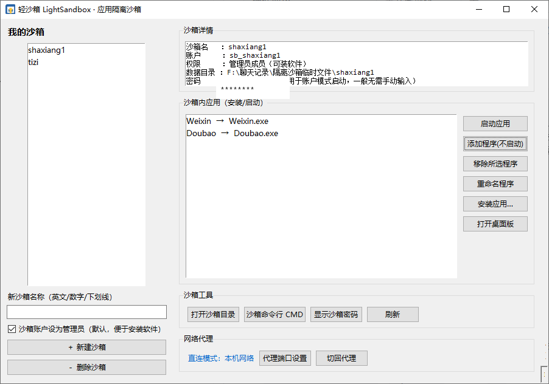
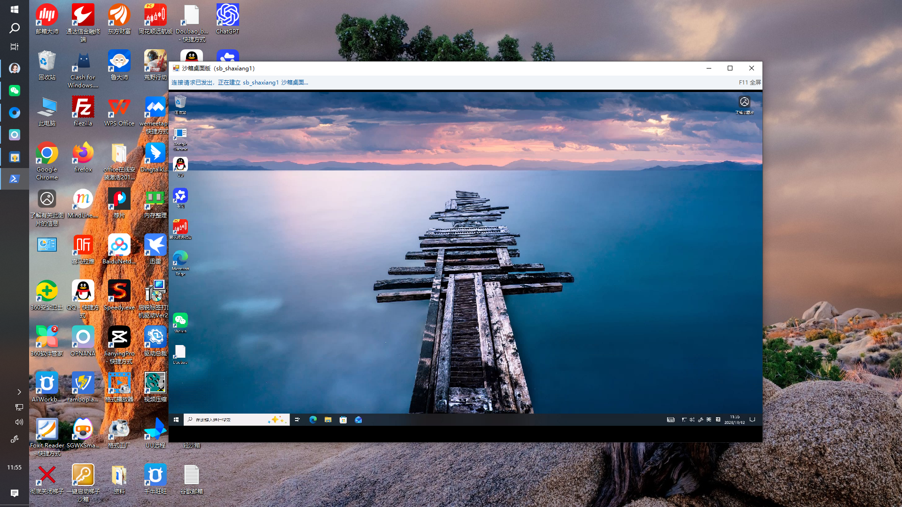

# 轻沙箱 LightSandbox v1.0

一个**比虚拟机更轻量**的 Windows 应用隔离沙箱。不用装虚拟机、不用装驱动，
让微信、豆包这类软件在沙箱里装多套、登不同账号，和主系统完全分开。

---

## 下载使用（普通用户直接下 EXE）

**普通用户不用装 Python，下载后双击即可运行**：

- 最新版下载地址（v1.0）：[**点此下载 LightSandbox-Setup-v1.0.exe**](https://github.com/35556559-sudo/my-tools/releases/download/v1.0/LightSandbox-Setup-v1.0.exe)
- 更多版本与更新说明：[GitHub Releases 页面](https://github.com/35556559-sudo/my-tools/releases/tag/v1.0)
- 下载后得到 `LightSandbox-Setup-v1.0.exe`，右键以管理员身份运行，按界面提示操作即可。
- 开发者若想从源码运行，见下文「环境要求」和「附录」。

---

## 核心应用场景

**场景一：程序多开**
每新建一个沙箱，就可以多开一个程序。同一个软件（微信、豆包等）在不同沙箱里各登各的账号，
互不冲突，主系统还能再登一个。

**场景二：梯子网络隔离（强烈推荐）**
沙箱内的梯子可以使用代理，且**只在该沙箱内生效**，沙箱外面用不到梯子网络，
这样能节省梯子的费用和流量额度。如果沙箱外开着微信，**一定要使用这个功能**——
微信一旦发生 IP 地址频繁切换，极易触发风控，把代理隔离在沙箱内可以让主系统的微信保持 IP 稳定。

---

## 一、它是什么 / 原理

每个沙箱 = **一个独立的 Windows 账户 + 一个独立的数据目录**。

- 沙箱内启动的软件，是以这个独立账户运行的（通过微软官方工具 PsExec 在当前桌面直接弹出窗口）；
- 软件的文档、配置（AppData）、用户注册表（HKCU）全部落在该账户自己的配置里，
  跟主系统账户**物理隔离**；
- 软件数据持久保存，关掉再开还在；可反复重装，不影响主系统里已装的同一软件；
- 还能一键打开该沙箱的**窗口化完整桌面**（基于 RDP），像在另一台电脑里操作。

和虚拟机的区别：

| 对比项 | 虚拟机 | 轻沙箱 |
|---|---|---|
| 是否要装系统/占用几十 GB | 要 | 不要 |
| 启动速度 | 分钟级 | 秒级 |
| 占内存 | 按 GB 计 | 按 MB 计 |
| 和主系统共用桌面/剪贴板 | 不便 | 直接共用 |
| 隔离强度 | 整机级（最强） | 账户/数据级（够日常用） |
| 硬件要求 | 需开虚拟化 | 无 |

> 注意：轻沙箱做的是「数据/账号隔离」，**不是防病毒沙箱**。
> 沙箱内软件仍和主系统同一台电脑，装来路不明的软件请谨慎。

## 二、目录结构

```
light-sandbox/
├── light_sandbox.py              主程序（界面 + 引擎，全部在此一个文件）
├── 启动沙箱.bat                   双击它打开界面（自动请求管理员权限）
├── 沙箱桌面客户端.ps1             窗口化 RDP 桌面客户端（由主程序调用）
├── FullScreenController.cs       桌面客户端全屏控制源码
├── RdpHost.cs                    RDP ActiveX 控件包装源码
├── 启动沙箱桌面.vbs               无黑框启动器
├── 轻沙箱架构图.html              隔离原理示意图（浏览器双击打开）
├── sandbox.ico                   程序图标
├── _selftest.py                  自检脚本（py -3 _selftest.py）
├── check_version.py              版本检查脚本
├── light_sandbox_config.example.json   配置模板（脱敏示例）
├── images/                        说明配图（主界面、桌面版截图）
└── README.md                     本说明
```

**首次运行后自动生成 / 需要自行准备的内容**（不随仓库分发）：

- `light_sandbox_config.json`：首次运行自动生成，记录你的沙箱和账户密码，**含敏感信息、不会被提交**。
  可参照 `light_sandbox_config.example.json` 手动填写。
- `PsExec64.exe`：微软 Sysinternals 官方工具，首次使用时程序会自动从官网下载；
  也可自行下载后放到程序目录。
- `FullScreenController.dll`、`RdpHost.dll`：由同名 `.cs` 用系统自带的 csc 编译生成，
  编译方法见下文「附录：从源码编译 dll」。

**沙箱数据目录**：默认在程序目录下的 `data\<沙箱名>\`（apps / Data / Downloads / Temp），
可在配置文件中修改。

**沙箱账户配置目录**：新账户首次登录时，由 Windows 自动在 `C:\Users\<账户名>` 生成，无需手动处理。

## 三、环境要求

- Windows 10 / 11（家庭版、专业版均可）
- Python 3
- 管理员权限（建账户必需；启动器会自动弹 UAC）
- 如需窗口化完整桌面，需安装 RDP Wrapper（开启本机多会话回环）

## 四、使用教程

### 第 1 步：打开程序
双击 **`启动沙箱.bat`**，弹出 UAC 提示时点「是」。界面标题为「轻沙箱 LightSandbox」。

### 第 2 步：新建沙箱
1. 左侧输入沙箱名，如 `wechat1`（限英文/数字/下划线，1-16 位）；
2. 保持勾选「沙箱账户设为管理员」（装软件需要）；
3. 点「＋ 新建沙箱」。创建在后台进行，成功后右侧显示账户名和数据目录。

> 想再开一个（比如给另一个微信账号），就再建一个沙箱，如 `wechat2`。

### 第 3 步：把电脑里已有的程序添加进沙箱
**不需要重新安装软件**。直接复用电脑里已经装好的程序，操作如下：

1. 选中刚建的沙箱，点右侧 **「添加程序(不启动)」** 按钮；
2. 在弹出的文件窗口里，**直接到桌面选择软件的图标**（或找到该软件的 .exe 主程序）；
3. 选中后程序就会出现在「沙箱内应用」列表里。

> 原理：程序文件本身共用、不重复占用空间，但它在沙箱里是以**独立账户**运行的，
> 登录态和数据与主系统完全隔离。软件多了可以用「重命名程序」改成中文好认的名字。

主界面各区域和按钮说明：



### 第 4 步：启动软件 / 打开桌面版
- 选中应用列表里的程序，点 **「启动应用」**，它就会以沙箱账户弹出窗口，直接登录你的新账号。
- **通常我们不使用桌面版**：桌面版需要额外打开一个独立页面，软件要在两个窗口之间来回管理，不方便。
  日常推荐直接在**同一个桌面**上管理所有打开的软件，窗口都在当前桌面，操作最省事。
- 只有需要完整桌面环境时，才点 **「打开桌面版」** 打开窗口化 RDP 桌面（按 F11 可切换全屏）。



完成！沙箱里的软件数据、登录态与主系统完全分开，两边可以同时登不同账号。

## 五、常用操作

| 操作 | 方法 |
|---|---|
| 多开一套软件 | 再新建一个沙箱，重复上面的步骤 |
| 直接用本机已装的软件 | 「添加程序」选本机已装的主程序 →「启动应用」，文件共用、不占重复空间，但以沙箱账户独立登录 |
| 给程序改中文名 | 选中程序 →「重命名程序」 |
| 打开窗口化完整桌面 | 选中沙箱 →「打开桌面版」 |
| 打开沙箱数据目录 | 选中沙箱 →「打开沙箱目录」 |
| 进沙箱命令行 | 选中沙箱 →「沙箱命令行 CMD」 |
| 查看/抄录账户密码 | 选中沙箱 →「显示沙箱密码」 |
| 删除沙箱 | 选中沙箱 →「－ 删除沙箱」（后台执行，删除账户 + 资料 + 数据目录，不可恢复） |

## 六、常见问题 FAQ

**Q1：为什么每次要点 UAC？**
建账户、以其他账户运行程序都需要管理员权限，这是 Windows 的安全机制，点「是」即可。

**Q2：PsExec 是什么？安全吗？**
微软 Sysinternals 官方工具，是 Windows 官方支持的"以指定账户在桌面运行程序"工具。
首次使用自动从微软官网下载；若杀毒软件提示，请添加信任（个别杀软会误报）。

**Q3：添加程序时怎么选？可以直接选桌面图标吗？**
可以。点「添加程序(不启动)」后，在文件窗口直接定位到桌面，选择软件的图标即可；
桌面没有的话，就找到软件安装目录里的 .exe 主程序。添加后可用「重命名程序」改成中文名。

**Q4：为什么建议沙箱账户是"管理员成员"？**
软件写入系统目录时需要权限，普通账户会失败。沙箱隔离靠的是"独立账户 + 独立数据"，不是靠降权限。

**Q5：能同时登录两个账号吗？**
能。两个沙箱各装一套、各登各的账号；主系统再登一个也没问题。

**Q6：删除沙箱后数据目录里有残留吗？**
删除操作会清理账户、该账户的用户资料和沙箱数据目录。装在共享位置（Program Files）的
卸载信息需在沙箱里用卸载程序处理。

**Q7：这个沙箱能防病毒吗？**
不能。它隔离的是"数据/账号"，不是"安全"。真要防毒，请用 Windows 自带的
Windows Sandbox（需 Win11 专业版+虚拟化）或 Sandboxie-Plus。

**Q8：沙箱会很占 C 盘吗？**
沙箱账户的用户资料由 Windows 自动放在 `C:\Users\<账户名>`，占用和普通账户相当；
沙箱的软件数据默认放在程序目录下的 data 目录，可在配置中指定到其他盘。删除沙箱时会一并清理。

## 七、已知限制（诚实说明）

1. **账户名不支持中文**（Windows 账户命名规则限制），沙箱名请用英文/数字/下划线；
2. 软件安装时若写入**全机共享**的注册表（HKLM / Program Files），这些写入是机器级的，
   但这类软件的**用户数据与登录态**仍隔离在沙箱账户里——对本项目目标（多账号）无影响；
3. Windows 防火墙是整机级、不按账户隔离，需要管理员权限运行（同类工具如 Sandboxie 同样需要）。

---

## 附录：从源码编译 dll

仓库只提供 `.cs` 源码，需要时用系统自带的 .NET 编译器 csc 生成 dll（无需安装额外软件）：

```powershell
$csc = "C:\Windows\Microsoft.NET\Framework64\v4.0.30319\csc.exe"
& $csc /target:library /out:RdpHost.dll RdpHost.cs
& $csc /target:library /out:FullScreenController.dll FullScreenController.cs
```

## 开源协议

本项目采用 [MIT 协议](LICENSE)，可自由使用、修改和分发，保留版权声明即可。

## 反馈与联系

使用中遇到问题、有功能建议或需要协助，欢迎通过微信联系：

- **微信号：damin7**（添加时请备注「轻沙箱」）

我会持续更新维护，反馈的问题会在后续版本中修复。
