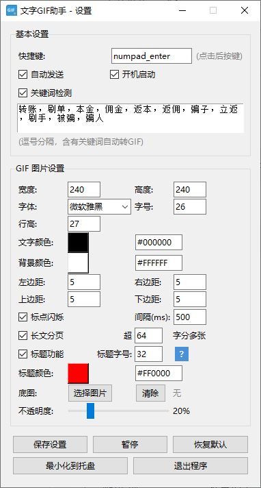

# 微信防封助手

一款配合微信 PC 版使用的 Windows 桌面工具。在微信聊天框打完字后，按一下快捷键，
文字会自动转换成一张纯文字 GIF 图片并发送出去，让原本以文本形式存在的内容以图片形式传递。

## 讲解视频

完整操作讲解视频（抖音，手机端观看体验更佳）：[点击观看讲解视频](https://v.douyin.com/o5f1DOshz9s/)

## 原理

微信对风险的识别源于对聊天文字的识别。当你发送的是 GIF 图片时，系统会将其判定为表情，
不会识别图片上的文字，从而规避对微信号的风控风险。

## 使用方法

- 双击图标打开软件，让它挂在后台即可。软件占用内存很小，打开后自动隐藏在任务栏；
  点击任务栏的三角号即可看到它正在运行，点击运行中的程序就能打开设置界面。
- 在界面中可以设置关键词。用电脑微信正常聊天时，一旦文字包含这些关键词，
  会自动生成 GIF 图片发送，而不是发送文字。
- 未触发关键词时，若想手动发送 GIF 图片，按小键盘 Enter 键即可；
  按大 Enter 键则是正常发送文字，快捷键支持自定义更改。
- 若想发送带标题的 GIF，在标题文字后加一个减号（-），减号之前的文字会自动放大、变红，
  成为标题。
- 若文字过多过长，会自动分成多张 GIF 图片，发送顺序保持不变，使内容读起来具有连续性。
- 以上快捷键仅在微信聊天窗口生效，在其他软件中输入不会触发。

## 效果展示


设置界面：



## 运行环境

- Windows 10 / Windows 11
- 已安装微信 PC 版
- Python 3.11（其他版本未逐一验证）

## 安装与运行

1. 安装依赖：

   ```bash
   pip install -r requirements.txt
   ```

2. 运行程序：

   ```bash
   python main.py
   ```

   或直接双击 `启动.bat`。

## 项目结构

```
.
├── main.py              程序入口
├── gui.py               图形界面与托盘
├── hotkey.py            快捷键管理
├── enter_hotkey.py      回车触发与发送逻辑
├── text_capture.py      输入文字捕获
├── gif_generator.py     GIF 生成
├── injector.py          图片注入与自动发送
├── window_detector.py   微信窗口识别
├── clipboard_utils.py   剪贴板操作
├── ocr_reader.py        屏幕文字识别
├── config.json          配置文件
├── settings.png         设置界面截图
├── assets/app.ico       程序图标
├── 启动.bat             Windows 启动脚本
├── 使用说明书.md        详细使用说明
├── 微信防封助手.spec    PyInstaller 打包配置
└── installer.iss        Inno Setup 安装包配置
```

## 自行打包

- 使用 PyInstaller 生成可执行文件：

  ```bash
  pyinstaller 微信防封助手.spec
  ```

- 使用 Inno Setup 编译 `installer.iss` 可生成安装包。

## 免责声明

本软件按"现状"提供，作者不承担因使用本软件造成的任何损失。请在遵守相关法律法规及
平台规则的前提下使用，使用后果由使用者自行承担。详见 [LICENSE](LICENSE)。

## 意见反馈

如对功能或缺陷有任何建议，欢迎通过本仓库的 **Issues** 提交，作者会统一评估处理。
未经授权，请勿自行修改或再分发本软件。
